A standalone KNN Regression package with leakage-safe splitting, scaling, cross-validation, tuning, feature selection, and holdout evaluation.

## 2. File and function index

| File | Responsibility | Main public functions |
|---|---|---|
| `__init__.py` | Exposes the package API. | Public imports listed below. |
| `data_split.py` | Creates a reproducible 80/20 train/holdout split. | `train_holdout_split`, `split_data` |
| `folds.py` | Creates positional five-fold assignments on training data. | `create_cv_folds`, `create_folds`, `FoldAssignment` |
| `feature_selection.py` | Selects and validates manual or automatic features. | `validate_features`, `select_features` |
| `knn_model.py` | Builds, fits, and predicts scaled KNN pipelines. | `create_knn_model`, `create_knn_pipeline`, `fit_knn_model`, `predict_knn` |
| `optimization.py` | Runs bounded grid search, elbow diagnostics, and holdout metrics. | `grid_search`, `optimize_hyperparameters`, `elbow_analysis`, `evaluate_holdout` |
| `main_knn_workflow.py` | Coordinates the complete interactive or programmatic workflow. | `run_knn_workflow`, `main` |
| `tests/` | Tests splitting, folds, features, pipelines, tuning, and workflow behavior. | pytest test functions |

## 3. Workflow diagram

```mermaid
flowchart LR
    A[User input] --> B[Feature selection and validation]
    B --> C[80/20 train/holdout split]
    C --> D[Five CV folds from training only]
    D --> E[Hyperparameter grid search]
    E -->|Each fold| S[Fit StandardScaler on fold training data]
    S --> F[Fit KNN and validate]
    F --> G[Select best CV configuration]
    G --> H[Fit scaler on complete training partition]
    H --> I[Fit final KNN pipeline]
    I --> J[Evaluate once on untouched holdout]
    C -. holdout excluded -.-> D
```



## 4. Quick start

Required input is a pandas DataFrame whose target column contains numeric, finite values. The input features should already have required preprocessing applied, but should not be scaled.

```python
import pandas as pd
from knn_regression.main_knn_workflow import run_knn_workflow

data = pd.read_csv("data.csv")

# Automatic eligible-feature inclusion (no prompts).
result = run_knn_workflow(data, target="price")

# Explicit feature selection.
result = run_knn_workflow(
    data,
    target="price",
    features=["area", "bedrooms", "age"],
)

print(result["selected_features"])
print(result["hyperparameters"])
print(result["cross_validation"])
print(result["holdout_metrics"])
```

Interactive mode asks whether to choose features manually:

```python
result = run_knn_workflow(data, target="price", interactive=True)
```

## 5. Detailed explanations

### Data and feature selection

`data_split.py` performs a seeded 80/20 split with scikit-learn's shuffle and returns DataFrames/Series preserving original indices and row correspondence. Manual selection requires a non-empty, duplicate-free list of existing numeric predictor columns. Missing and non-finite features are rejected rather than silently imputed. Automatic selection uses numeric predictors, reports constant features as excluded, and rejects an empty result.

### Train/holdout split and folds

`create_cv_folds` uses `KFold` positions within the training partition only. Five folds are the default. Every training row belongs to exactly one validation fold, and each fold's other four partitions form its training set. The holdout is never supplied to this function. Custom fold counts require at least as many training rows as folds, and configurations whose neighbor count exceeds a fold's training sample count are reported as failures.

### Scaling and leakage prevention

Each `Pipeline` contains `StandardScaler` followed by `KNeighborsRegressor`. During grid search the scaler is fitted independently on every fold's training rows and transforms only that fold's validation rows. For final fitting, one scaler is fitted on all training rows, and the pipeline transforms the untouched holdout. Holdout rows never fit a scaler or choose a configuration. Final prediction therefore accepts raw values for the selected feature columns and applies the fitted scaler internally.

### Hyperparameters

The default search evaluates 28 configurations from seven neighbor counts (`3, 5, 7, 11, 15, 21, 31`), two weighting modes (`uniform, distance`), and two Minkowski powers (`p=1, 2`). This is 140 fold-level fits. The configured folds are reused exactly. Selection defaults to maximum mean cross-validation R²; when R² values are tied, minimum mean MAE and then the configuration tuple provide deterministic ordering. Failed folds and undefined/non-finite metrics are retained in the report rather than hidden. The implementation supports a custom dictionary search space.

Elbow analysis accepts neighbor values and reports mean/standard deviation of MAE for diagnostics. It is not used to choose the final configuration.

### Metrics and errors

Reports contain fold-level and summary R², MAE, and RMSE. RMSE is the square root of mean squared prediction error. Holdout metrics are calculated only after tuning and final fit. Invalid frames, targets, features, missing/non-finite values, unsupported parameters, insufficient samples, and empty grid results raise clear exceptions or failures. The package should receive at least five rows overall and five training rows for default five-fold CV; larger data are recommended for meaningful holdout results.

### Reproducibility and limitations

`random_state=42` controls both splitting and K-fold generation unless callers override it. Feature order follows the supplied order or the DataFrame column order. Current limitations are positional CV indices, no persistence/caching, no automatic feature-subset search, and no automatic handling of missing values. Correlation diagnostics are intentionally not implemented.

## 6. Testing

Run the package tests from the repository root:

```text
python -m pytest knn_regression/tests
```

Coverage includes reproducible splits and non-overlapping indices, stable folds with no holdout leakage, manual and automatic feature validation, constant removal, pipeline scaling/fitting/prediction, bounded deterministic tuning, invalid neighbors and sample counts, elbow output, holdout evaluation, and programmatic workflow invocation without prompts.
