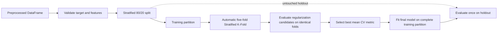

A standalone Logistic Regression classification package with leakage-safe splitting, stratified cross-validation, regularization tuning, and holdout evaluation.

## 2. File and function index

| File | Responsibility | Main public functions |
|---|---|---|
| `__init__.py` | Exposes the public package API. | Public imports listed below. |
| `data_split.py` | Creates reproducible stratified train/holdout splits. | `train_holdout_split`, `split_data` |
| `folds.py` | Creates reusable five-fold stratified assignments. | `create_cv_folds`, `create_folds`, `FoldAssignment` |
| `feature_selection.py` | Selects and validates explicit or automatic numeric features. | `validate_features`, `select_features` |
| `logistic_model.py` | Creates and fits Logistic Regression models. | `create_model`, `fit_model`, `predict`, `predict_proba` |
| `optimization.py` | Runs fixed-fold tuning and classification evaluation. | `optimize_hyperparameters`, `classification_metrics`, `evaluate_holdout` |
| `main_logistic_workflow.py` | Coordinates tuning, final fitting, and holdout evaluation. | `run_logistic_workflow`, `main` |
| `tests/` | Tests splitting, folds, features, models, tuning, and workflow behavior. | pytest test functions |

## 3. Workflow diagram



## 4. Quick start

```python
import pandas as pd
from logistic_regression.main_logistic_workflow import run_logistic_workflow

data = pd.DataFrame({
    "x1": [0.0, 0.2, 0.7, 1.0, 1.2, 1.8, 2.0, 2.4, 2.8, 3.0, 3.3, 3.6] * 4,
    "x2": [1.0, 1.1, 1.3, 1.5, 1.7, 1.9, 2.1, 2.3, 2.5, 2.7, 2.9, 3.1] * 4,
    "target": [0, 0, 0, 0, 0, 0, 1, 1, 1, 1, 1, 1] * 4,
})

result = run_logistic_workflow(
    data,
    target="target",
    features=["x1", "x2"],
    configurations=[
        {"penalty": "l1", "C": 0.1},
        {"penalty": "l2", "C": 1.0},
        {"penalty": "elasticnet", "C": 1.0, "l1_ratio": 0.5},
    ],
)

print(result["selected_features"])
print(result["best_regularization"])
print(result["holdout_metrics"])
print(result["confusion_matrix"])
```

## 5. Detailed explanations

### data_split.py

`train_holdout_split` validates the target and returns four objects in the same order as existing modules: training features, holdout features, training target, and holdout target. It uses a seeded stratified 80/20 split when every class supports preserving proportions.

### folds.py

`create_cv_folds` uses training data positions with `StratifiedKFold`. It validates class counts and returns immutable fold assignments containing training and validation positions. The same assignments are passed to every optimization candidate.

### feature_selection.py

Automatic selection uses all numeric, non-constant columns except the target. Explicit selection must contain existing non-target numeric columns and rejects duplicates, missing values, and non-finite values. Features must already be encoded and scaled when required; this module performs no encoding or scaling.

### logistic_model.py

L1 uses `saga`; L2 uses `lbfgs` by default and may use `saga`; Elastic Net requires `saga` and a valid `l1_ratio`. Binary and multiclass targets are handled by scikit-learn. Scaling is intentionally left to preprocessing.

### optimization.py

Candidates are evaluated with the supplied fixed folds. Each fold produces accuracy, precision, recall, F1, ROC-AUC where applicable, and a confusion matrix. By default configurations are ranked by highest mean cross-validation F1, with mean/std in each metric report.

### main_logistic_workflow.py

The workflow performs feature selection before tuning, creates training-only folds, selects a configuration, fits the final model on all training rows, and evaluates the untouched holdout once. It returns the model, selected names, configuration, CV report, holdout metrics, and confusion matrix.

## 6. Regularization explanation

### L1

L1 promotes sparse coefficients and can set coefficients exactly to zero. It uses `saga`.

### L2

L2 shrinks coefficients toward zero without normally making them exactly zero. It uses `lbfgs` by default.

### Elastic Net

Elastic Net combines L1 and L2. `l1_ratio=1` is L1-like and `l1_ratio=0` is L2-like; this implementation allows the valid range `(0, 1]`.

### C versus alpha

Scikit-learn accepts `C`, not `alpha`. Conceptually, `C = 1 / alpha`: smaller `C` means stronger regularization and larger `C` means weaker regularization.

## 7. Classification metrics

Accuracy, precision, recall, and F1 are reported for every evaluation. Binary precision, recall, and F1 use binary averaging by default; multiclass uses macro averaging unless another supported average is selected. Holdout values are computed separately from cross-validation values.

For binary ROC-AUC, probabilities for the positive class are used; the positive class defaults to the greater of the two classes and can be configured. Multiclass ROC-AUC uses one-vs-rest macro averaging when every required class and probability column is available. ROC-AUC is `None` when it cannot be calculated reliably, rather than being fabricated.

## 8. Testing

```text
python -m pytest logistic_regression/tests
```
