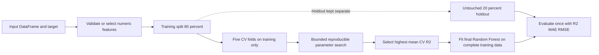

A standalone Random Forest Regression module for reproducible feature selection, bounded hyperparameter tuning, final training, and holdout evaluation without scaling or agent integration.

## 2. File and function index

| File | Responsibility | Main public functions |
|---|---|---|
| `__init__.py` | Exposes the public package API. | Public imports documented below. |
| `data_split.py` | Performs a reproducible 80/20 train/holdout split. | `train_holdout_split`, `split_data` |
| `folds.py` | Creates reusable five-fold assignments on training rows. | `create_cv_folds`, `create_folds`, `FoldAssignment` |
| `feature_selection.py` | Validates explicit features or selects numeric, nonconstant predictors. | `validate_features`, `select_features` |
| `random_forest_model.py` | Creates, fits, and predicts Random Forest regressors. | `create_random_forest_model`, `fit_random_forest_model`, `predict_random_forest` |
| `optimization.py` | Samples bounded configurations and evaluates deterministic CV. | `random_search`, `optimize_hyperparameters`, `evaluate_configuration`, `evaluate_holdout` |
| `main_rf_workflow.py` | Coordinates the complete workflow and returns all results. | `run_random_forest_workflow`, `run_rf_workflow`, `main` |
| `tests/` | Tests splitting, folds, features, tuning, and workflow behavior. | pytest test functions |

## 3. Mermaid workflow diagram



## 4. Quick start

```python
import pandas as pd
from random_forest_regression import run_random_forest_workflow

# data.csv contains predictor columns plus the numeric target column.
data = pd.read_csv("data.csv")

# Automatic selection of numeric, nonconstant predictors.
result = run_random_forest_workflow(data, target="price")

# Explicit feature selection.
result = run_random_forest_workflow(
    data,
    target="price",
    features=["area", "bedrooms", "age"],
    n_iter=40,
    random_state=42,
)

print(result["selected_features"])
print(result["best_configuration"])
print(result["cross_validation"])
print(result["holdout_metrics"])
```

## 5. Detailed explanations

### data_split.py

`train_holdout_split` validates the frame, target, target finiteness, and minimum dataset size, then performs a seeded shuffle split. It returns training features, holdout features, training targets, and holdout targets while preserving DataFrame indices. The workflow requires at least 10 rows and verifies that the resulting partitions contain at least five training rows and one holdout row.

### folds.py

`create_cv_folds` builds five `KFold` assignments on the positional indices of the supplied training partition. Each training row occurs once in validation; all reused folds are immutable value objects containing NumPy training and validation index arrays. No holdout data or persistent storage is involved.

### feature_selection.py

Explicit selection rejects duplicates, missing columns, target-as-feature, nonnumeric columns, missing values, and non-finite values. Automatic selection retains numeric predictors, excludes the target, and removes constant columns. Missing/non-finite automatic features are rejected because the module assumes preprocessing is complete. Feature selection runs on training data only.

### random_forest_model.py

`create_random_forest_model`, `fit_random_forest_model`, and `predict_random_forest` wrap `RandomForestRegressor`. Random Forests are fitted directly without scaling. Fixed defaults include `random_state=42`, `n_jobs=-1`, and `criterion="squared_error"`; these remain configurable separately from the six tuned parameters.

### optimization.py

`optimize_hyperparameters` is the primary bounded tuning interface. It samples from a supplied or default parameter space using sklearn `ParameterSampler`, removes duplicate configurations, evaluates each configuration with the same supplied folds, and reports every successful or failed fold. `n_iter` defaults to 40. The model receives the workflow's `random_state` and fixed settings during every fit.

### main_rf_workflow.py

`run_random_forest_workflow` validates the DataFrame, splits first, selects features using training data, creates folds, tunes, fits a final model, and evaluates holdout exactly once. It requires no prompts and returns `model`, `selected_features`, `best_configuration`, `cross_validation`, `holdout_metrics`, and `folds`.

## 6. Evaluation and optimization

The bounded search tunes exactly these six parameters:

- `n_estimators`: number of trees.
- `max_depth`: maximum individual tree depth; `None` allows unrestricted depth subject to other constraints.
- `min_samples_split`: minimum rows required before splitting a node.
- `min_samples_leaf`: minimum rows required in a leaf.
- `max_features`: fraction, count, or supported sklearn mode considered at each split.
- `max_leaf_nodes`: maximum leaves per tree; `None` disables this constraint.

The default space is deliberately finite and tuning is sampled rather than Cartesian. Only successful configurations are considered, and identical sampled configurations are removed where possible. Configurations that fail in individual folds are reported explicitly. A maximum of `n_iter` distinct configurations is returned in the default workflow; the actual count may be smaller if the sample or space contains duplicates. Selection uses highest mean cross-validation R². Equal-R² configurations use mean MAE and a stable parameter tuple as deterministic tie-breakers, but holdout metrics never participate in selection.

All returned metrics are R², MAE, and RMSE. R² measures explained variance, MAE is the mean absolute prediction error, and RMSE is the square root of mean squared prediction error. Cross-validation summaries include each metric's mean and population standard deviation plus fold-level values. Non-finite or undefined fold evaluations are recorded as failures; holdout metrics are computed from one fitted model and one untouched holdout partition.

## 7. Testing

Run the module tests from the repository root:

```text
python -m pytest random_forest_regression/tests -q
```

Tests cover splitting and overlap, five reproducible folds, explicit and automatic feature selection, bounded optimization, repeated-search reproducibility, invalid parameters and small datasets, holdout metrics, and the complete workflow result structure.
